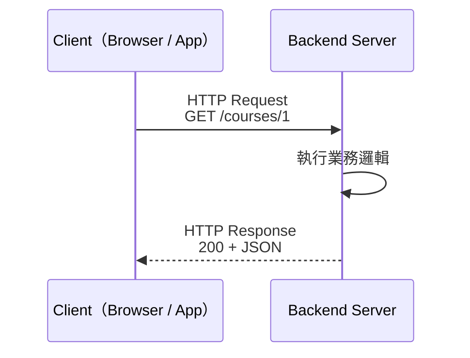
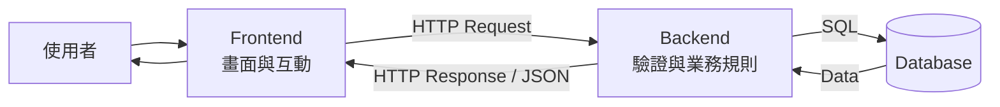
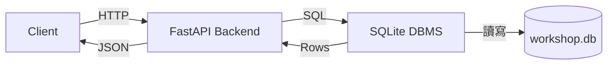
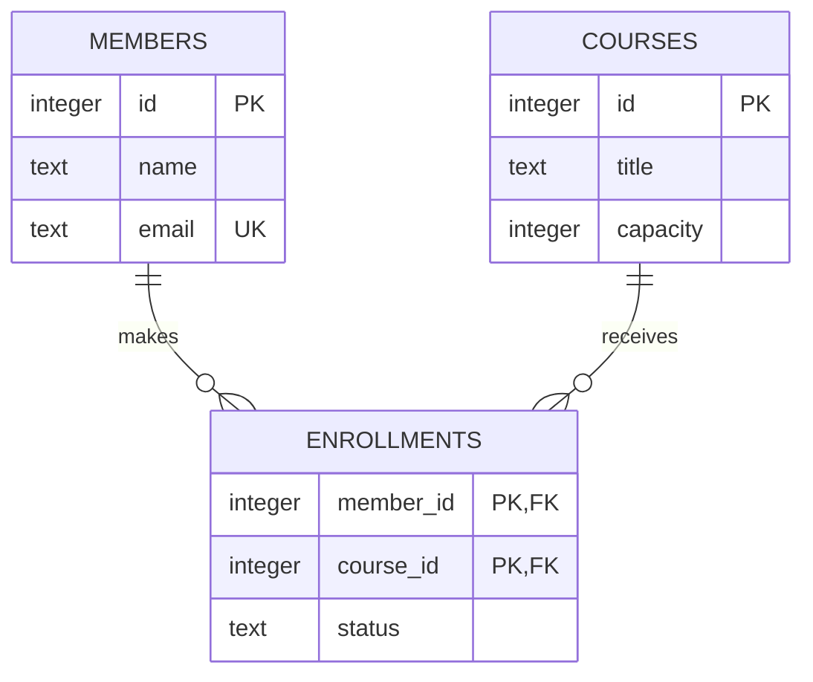

Notion 講義快照

取得時間：2026-09-23。Notion 最後編輯：2026-09-23T13:05:14.321Z。原始文字與程式碼保留；網站採用的修正版本見 notion-code.json 與 docs/errata.md。暫時性圖片網址不收錄，圖解從本機載入。

# Syllabus
## Learning Goals
完成本次工作坊後，你應該能夠：
- 說明 Client、Server、Backend、Database 之間的分工。
- 看懂 HTTP Request 與 Response，並選擇合適的 Method 和 Status Code。
- 以 REST 的 Resource 思維設計 CRUD Endpoint。
- 使用 FastAPI 建立具有 Path、Query 與 Request Body 的 API。
- 使用 Pydantic 定義輸入、更新與輸出模型，讓資料自動驗證。
- 使用 Python 內建的 `sqlite3` 建立資料表並安全執行基本 SQL。
## Schedule
<table header-row="true">
<tr>
<td>主題</td>
<td>產出</td>
</tr>
<tr>
<td>課程介紹與環境確認</td>
<td>可以執行 Python 與 FastAPI CLI</td>
</tr>
<tr>
<td>Python Recap</td>
<td>看懂後續型別與資料結構</td>
</tr>
<tr>
<td>Backend & Web Overview</td>
<td>看懂一次 HTTP 往返</td>
</tr>
<tr>
<td>Introduction to FastAPI</td>
<td>完成 Course CRUD API</td>
</tr>
<tr>
<td>Break</td>
<td>—</td>
</tr>
<tr>
<td>RESTful API Design</td>
<td>設計 Enrollment Endpoint</td>
</tr>
<tr>
<td>Database & SQL</td>
<td>建立 SQLite Schema 並操作 CRUD</td>
</tr>
<tr>
<td>Final Lab & What's Next</td>
<td>對照 API、Schema 與後續整合方向</td>
</tr>
</table>
## Prerequisites
本講義使用 Python 3.10 以上版本。以下在 macOS／Linux 以 `python3` 指向 Python 3；Windows 可將它換成 `py`。進入 Virtual Environment 後則統一使用 `python`。
```bash
python3 --version
```
建立專案與 Virtual Environment：
```bash
mkdir backend-workshop
cd backend-workshop
python3 -m venv .venv
```
macOS／Linux 啟用方式：
```bash
source .venv/bin/activate
```
Windows PowerShell 啟用方式：
```powershell
.venv\Scripts\Activate.ps1
```
安裝 FastAPI 與開發伺服器：
```bash
python -m pip install "fastapi[standard]"
```
SQLite 已包含在 Python 標準函式庫，不需要另外安裝。
# Recap: Python
雖然學員們對 Python 應該有一定程度上認識，但此次工作訪會用到一些更進階的語法。為了幫助你完成這此工作訪， 我們先來複習一下：Function、Class、`list`、`dict` 與 Exception。
## Function
```python
def find_course(courses: list[dict], course_id: int) -> dict:
    for course in courses:
        if course["id"] == course_id:
            return course

    # 沒有找到對應課程，拋出異常
    raise ValueError(f"Course {course_id} not found")
```
- `courses: list[dict]` 表示參數預期是一組課程。
- `course_id: int` 表示 ID 預期是整數。
- `-> dict` 表示函數預期回傳一筆課程資料。
- Type Hint 主要幫助人、Editor 與靜態分析工具理解程式，本身不保證 Runtime Validation。稍後會由 Pydantic 負責真正的資料驗證。
## List, Dictionary, and Exception
```python
courses = [
    {"id": 1, "title": "Backend Workshop", "capacity": 30},
    {"id": 2, "title": "Database Workshop", "capacity": 25},
]

try:
		# find_course 的返回是一個 dict
    course = find_course(courses, 3)
    print(course["title"])
except ValueError as error:
    print(error)
```
- `list` 將一系列 `dict` 包成一個陣列
-  `dict` 用 Key-Value 儲存資料，並使用 Key 來檢索
## Exercise: Filter Courses
實作 `filter_courses(courses, minimum_capacity)`，回傳容量大於等於 `minimum_capacity` 的課程，並補上 Type Hint。
<details>
<summary>參考解答</summary>
	```python
def filter_courses(
    courses: list[dict], minimum_capacity: int
) -> list[dict]:
    return [
        course
        for course in courses
        if course["capacity"] >= minimum_capacity
    ]
	```
</details>
# Backend & Web Overview
## Client-Server Architecture
當使用者訪問網站時，需要與伺服器進行互動。在這種情況下，使用者的瀏覽器就是 Client (因為它被服務)，伺服器就是 Server (因為它服使用者)。
通常由 Client 主動發出 Request (請求)，由 Server 接收、處理，再回傳 Response。

- **Client**：瀏覽器，手機 App 等發出請求 (Request) 者。
- **Server**：持續等待 Request，收到 Request 後處理並產生 Response。
- **Backend**：Server 端負責權限、驗證、商業規則與資料存取的程式。
## Frontend, Backend, and Database
三者的典型分工如下：

以「社員報名課程」為例：
1. Frontend 收集使用者點選的課程，發送 Request 給 Backend 處理。
2. Backend 收到 Fronted 的 Request 後，訪問 Database 確認使用者身分、課程是否存在、是否重複報名及是否尚有名額。
3. Database 保存報名關係。
4. Backend 回傳結果，Frontend 顯示成功或錯誤訊息。
## HTTP Request and Response
HTTP 是 Client 與 Server 交換訊息的共同格式。以下是一個簡化的 Request：
```plain text
POST /courses HTTP/1.1
Host: api.example.com
Content-Type: application/json

{
  "title": "Backend Workshop",
  "capacity": 30
}
```
它包含：
- **Method**：`POST`，描述想做的操作。此處 `POST` method 可以用來在後端建立資料。其他的 method 還包含 `GET, DELETE, ...`  等等。
- **Path**：`/courses`，指出 API 操作的資料對象，這種對象被稱為 Resource。可以是課程、文章、訂單等資料。
- **Protocol Version：**`HTTP/1.1` ，表示使用的 HTTP 協定版本。
- **Header**：Request 的 Metadata，以 Key-Value 的形式表示，例如內容格式與憑證。
	- `HOST` ：這個 Request 要傳送到哪裡
	- `Content-Type` ：標示 Request Body 的資料是什麼格式，此處是 `JSON`。
- **Body**：要傳給 Server 的資料，這裡採用 JSON。
常見的 method 包含：
<table header-row="true">
<tr>
<td>Method</td>
<td>常見用途</td>
<td>範例</td>
</tr>
<tr>
<td>`GET`</td>
<td>讀取 Resource</td>
<td>取得課程清單</td>
</tr>
<tr>
<td>`POST`</td>
<td>建立 Resource 或觸發動作</td>
<td>新增課程</td>
</tr>
<tr>
<td>`PUT`</td>
<td>完整取代 Resource</td>
<td>替換整筆課程資料</td>
</tr>
<tr>
<td>`PATCH`</td>
<td>部分更新 Resource</td>
<td>只修改課程容量</td>
</tr>
<tr>
<td>`DELETE`</td>
<td>刪除 Resource</td>
<td>刪除課程</td>
</tr>
</table>
Server 可能回傳：
```plain text
HTTP/1.1 201 Created
Content-Type: application/json
Location: /courses/3

{
  "id": 3,
  "title": "Backend Workshop",
  "capacity": 30
}
```
Response 包含：
- **Status Code：**`201 Created` 代表資料建立成功
- **Header **
	- `Content-Type` ：標示 Request Body 的資料是什麼格式，此處是 `JSON`。
	- `Location` ：表示剛建立的 resource 位於位置，下次訪問 resource 可以通過此 URL 訪問。
- **Body：**要回給 Client 的資料，這裡採用 JSON。
常見 Status Code：
<table header-row="true">
<tr>
<td>Code</td>
<td>意義</td>
</tr>
<tr>
<td>`200 OK`</td>
<td>成功</td>
</tr>
<tr>
<td>`201 Created`</td>
<td>已建立</td>
</tr>
<tr>
<td>`204 No Content`</td>
<td>成功但沒有 Body</td>
</tr>
<tr>
<td>`400 Bad Request`</td>
<td>Request 不符合應用規則</td>
</tr>
<tr>
<td>`404 Not Found`</td>
<td>Resource 不存在</td>
</tr>
<tr>
<td>`409 Conflict`</td>
<td>與目前狀態衝突，例如重複建立 Resource</td>
</tr>
<tr>
<td>`422 Unprocessable Content`</td>
<td>格式可解析，但內容驗證失敗</td>
</tr>
<tr>
<td>`500 Internal Server Error`</td>
<td>Server 發生未預期錯誤</td>
</tr>
</table>
`2xx` 代表成功、`4xx` 代表 Client 端輸入或狀態問題、`5xx` 代表 Server 端問題。不要所有情況都回傳 `200`，也不要把正常的輸入錯誤回應成 `500`。
## API
**API（Application Programming Interface）** 是讓兩個軟體相互溝通的規則契約，在本文中通常用來溝通前後端。
一個設計好的 Web API 通常會定義：
- 可使用的 Method 與 Path：用來說明要對哪個網址做什麼操作。
- Path、Query、Header 與 Body 的格式：用來說明要把資料放在哪、用什麼格式傳過來。
- 成功時的 Response Schema 與 Status Code：若請求成功，需要回傳什麼資料，以及告訴你本次請求的處理情況。
例如 `GET /courses/1` 的契約可以是：「若課程存在，回傳 `200` 與 Course JSON；若不存在，回傳 `404`。」前後端只要共同遵守契約，就能分工實作。
```plain text
GET /courses/12?include_enrollments=true
```
- **Path Parameter**：識別特定 Resource，例如 Course ID `12`。
- **Query Parameter**：`?` 後的額外查詢參數 `include_enrollments`，篩選或調整呈現，例如是否包含報名資訊。
# RESTful API Design
## What is REST
**REST（Representational State Transfer）** 是設計 Web API 的一組架構風格，核心思想是用 URL 表示 Resource，用 HTTP Method 表示操作。而且，每個請求應包含完整資訊，不依賴前一次請求 (稱為 Stateless)。
課程報名系統的 Resource 包含：
- `courses`：課程。
- `members`：社員。
- `enrollments`：社員與課程之間的報名關係。
比較以下命名：
```plain text
POST /createCourse       # 動作寫進 Path
POST /courses            # 對 courses 集合建立新 Resource (RESTful)

GET /getCourse?id=3      # 所有操作擠在同一種 URL
GET /courses/3           # 用 Path 識別 Resource (RESTful)
```
使用 REST 可以統一介面，保證清晰的語意。Stateless 保證每個 Request 可以單獨處理，不用依賴 Server 保存先前的請求狀態。
# Introduction to FastAPI
FastAPI 是用 Python 快速建立 Web API 的現代後端框架。
## Your First FastAPI Application
在專案根目錄建立 `main.py`：
```python
from fastapi import FastAPI

# 建立 FastAPI 應用程式實例，並設定 API 標題
app = FastAPI(title="Course API")


# 定義 GET / 這個 API endpoint
@app.get("/")
def root() -> dict[str, str]:
    # 回傳 JSON 格式的資料
    return {"message": "Hello, backend!"}
```
啟動 Development Server：
```bash
fastapi dev main.py
```
開啟 [http://127.0.0.1:8000/](http://127.0.0.1:8000/)，應看到：
<!-- Notion 圖片省略；本站使用本機圖解。 -->
`@app.get("/")` 把 `GET /` 綁定到 `root` Function。FastAPI 收到符合的 Request 時會呼叫 `root`，並把回傳的 `dict` 序列化為 JSON。
## Routes and Endpoints
**Endpoint** 常指對外提供的 Method + Path 與其處理程式，例如 `GET /courses/{course_id}`。
而 **Route** 是配對規則，說明收到什麼樣的 Request，要交給哪個處理程式。例如將 `GET /courses/{course_id}` 分配到 `get_course()` 。
先在 `main.py` 加入一份記憶體資料：
```python
courses = [
    {"id": 1, "title": "Backend Workshop", "capacity": 30},
    {"id": 2, "title": "Database Training", "capacity": 25},
]


@app.get("/courses")
def list_courses(q: str | None = None) -> list[dict]:
		# 這裡 q 就是 query parameter
    if q is None:
        return courses
    return [
		    course 
				for course in courses 
				if q.lower() in course["title"].lower()
		]


@app.get("/courses/{course_id}")
def get_course(course_id: int) -> dict:
    for course in courses:
        if course["id"] == course_id:
            return course
    return {"error": "Course not found"}
```
嘗試以下 URL：
- `GET /courses`：取得全部課程。
- `GET /courses?q=database`：使用 Query Parameter 篩選。
- `GET /courses/1`：`course_id` 是 Path Parameter，FastAPI 會將它轉成 `int`。
- `GET /courses/abc`：無法轉成 `int`，FastAPI 自動回傳 `422` (格式可解析，但內容驗證失敗)。
<columns>
	<column ratio="37.5">
<!-- Notion 圖片省略；本站使用本機圖解。 -->
	</column>
	<column ratio="62.5">
<!-- Notion 圖片省略；本站使用本機圖解。 -->
	</column>
</columns>
<!-- Notion 圖片省略；本站使用本機圖解。 -->
目前找不到課程時仍回傳 `200`，而且輸出只是鬆散的 `dict`。下一節會修正這些問題。
## Pydantic Validation
Pydantic 是用 Python 型別定義並驗證資料結構的函式庫，常用在 FastAPI 中驗證 Request Body、規範 Response 格式。
```python
# 把「型別」和「額外限制」組合在一起
from typing import Annotated

# BaseModel 用來定義一個 Pydantic 資料模型。
# Field 替欄位加入額外限制或資訊，例如範圍、預設值、描述
# StringConstraints 專門設定字串限制，例如最短長度、最長長度、正規表示式
from pydantic import BaseModel, Field, StringConstraints


CourseTitle = Annotated[
    str,
    # 限制 CourseTitle 為去掉首尾空白後，长度介於 1～100 的字串
    StringConstraints(strip_whitespace=True, min_length=1, max_length=100),
]


class CourseCreate(BaseModel):
    title: CourseTitle
    # capacity 是整數，且 0 < capacity <= 500
    capacity: int = Field(gt=0, le=500)


class CourseUpdate(BaseModel):
    title: CourseTitle | None = Field(
        default=None,
        description="省略或 null 代表不修改",
    )
    capacity: int | None = Field(
        default=None,
        gt=0,
        le=500,
        description="省略或 null 代表不修改",
    )


class Course(CourseCreate):
    id: int
```
建立、部分更新與輸出的需求不同，因此分成三個 Model：
- `CourseCreate`：Client 建立課程時必須提供 `title`、`capacity`。
- `CourseUpdate`：所有欄位都可省略；本例也接受 `null`，並將它視為不修改，適合部分更新。
- `Course`：Response 比建立輸入多了由 Server 產生的 `id`。
以下是本次工作坊可直接執行的完整 `main.py`。這是課前提供與課後查閱的 Reference Implementation；課堂中只逐步實作核心 Route。請用它取代前面的練習版本：
```python
from typing import Annotated

from fastapi import FastAPI, HTTPException, Path, Query, Response, status
from pydantic import BaseModel, Field, StringConstraints

app = FastAPI(title="Course API", version="1.0.0")


CourseTitle = Annotated[
    str,
    StringConstraints(strip_whitespace=True, min_length=1, max_length=100),
]


class CourseCreate(BaseModel):
    title: CourseTitle
    capacity: int = Field(gt=0, le=500)


class CourseUpdate(BaseModel):
    # 欄位可省略；本例把 null 視為不修改。
    title: CourseTitle | None = Field(
        default=None,
        description="省略或 null 代表不修改",
    )
    capacity: int | None = Field(
        default=None,
        gt=0,
        le=500,
        description="省略或 null 代表不修改",
    )


class Course(CourseCreate):
    id: int


CourseId = Annotated[int, Path(ge=1, description="Course ID")]

courses: dict[int, Course] = {
    1: Course(id=1, title="Backend Workshop", capacity=30),
    2: Course(id=2, title="Database Training", capacity=25),
}
next_course_id = 3


def find_course(course_id: int) -> Course:
    course = courses.get(course_id)
    if course is None:
        raise HTTPException(status_code=404, detail="Course not found")
    return course


@app.get("/")
def root() -> dict[str, str]:
    return {"message": "Course API is running"}


@app.get("/courses", response_model=list[Course])
def list_courses(
    q: str | None = Query(default=None, min_length=1, max_length=50),
    min_capacity: int | None = Query(default=None, ge=1),
) -> list[Course]:
    result = sorted(courses.values(), key=lambda course: course.id)

    if q is not None:
        keyword = q.casefold()
        result = [course for course in result if keyword in course.title.casefold()]

    if min_capacity is not None:
        result = [
            course for course in result if course.capacity >= min_capacity
        ]

    return result


@app.get("/courses/{course_id}", response_model=Course)
def get_course(course_id: CourseId) -> Course:
    return find_course(course_id)


@app.post(
    "/courses",
    response_model=Course,
    status_code=status.HTTP_201_CREATED,
)
def create_course(payload: CourseCreate, response: Response) -> Course:
    global next_course_id

		# 將 payload 轉成 `dict` 後餵給 `Course`
    course = Course(id=next_course_id, **payload.model_dump())
    courses[course.id] = course
    next_course_id += 1
    response.headers["Location"] = f"/courses/{course.id}"
    return course


@app.patch("/courses/{course_id}", response_model=Course)
def update_course(course_id: CourseId, payload: CourseUpdate) -> Course:
    stored_course = find_course(course_id)
    # 忽略沒有傳入的欄位與值為 `none` 的欄位
    changes = payload.model_dump(exclude_unset=True, exclude_none=True)

    if not changes:
        raise HTTPException(status_code=400, detail="No fields to update")

    updated_course = Course.model_validate(
		    # 用 changes 覆蓋 stored_course 的值
        {**stored_course.model_dump(), **changes}
    )
    courses[course_id] = updated_course
    return updated_course


@app.delete(
    "/courses/{course_id}",
    status_code=status.HTTP_204_NO_CONTENT,
    response_class=Response,
)
def delete_course(course_id: CourseId) -> Response:
    find_course(course_id)
    del courses[course_id]
    return Response(status_code=status.HTTP_204_NO_CONTENT)
```
重新執行 `fastapi dev main.py` 後，可以用 `curl` 測試：
```bash
curl http://127.0.0.1:8000/courses

curl "http://127.0.0.1:8000/courses?q=backend&min_capacity=20"

# -i: 顯示 response headers
# -X: 指定 method，若沒有這個 flag 默認為 GET
curl -i -X POST http://127.0.0.1:8000/courses \
  -H "Content-Type: application/json" \
  -d '{"title":"API Design","capacity":40}'

curl -X PATCH http://127.0.0.1:8000/courses/1 \
  -H "Content-Type: application/json" \
  -d '{"capacity":35}'

curl -i -X DELETE http://127.0.0.1:8000/courses/2
```
## Swagger UI
Swagger UI 是一個可以直接查看和測試 API 的網頁介面。
FastAPI 會根據 Route、Type Hint 與 Pydantic Model 幫你產生這樣的頁面，訪問 [http://127.0.0.1:8000/docs](http://127.0.0.1:8000/docs) 來打開。
<!-- Notion 圖片省略；本站使用本機圖解。 -->
在 `/docs` 中展開 `POST /courses`，點選 **Try it out**，便可直接送出 Request。
<!-- Notion 圖片省略；本站使用本機圖解。 -->
可以測試以下 Body 並觀察 Response：
```json
{
  "title": "System Design",
  "capacity": 50
}
```
<!-- Notion 圖片省略；本站使用本機圖解。 -->
也可以測試會導致驗證失敗的 Body：
```json
{
  "title": "",
  "capacity": 0
}
```
<!-- Notion 圖片省略；本站使用本機圖解。 -->
# Database
目前的程式範例把資料存在在 `dict` 中，這麼做會有幾個限制：
- Server 重新啟動後資料消失。
- 若啟動多個程式，則每個程式各自持有不同副本。
**Database（資料庫）** 是有組織的資料集合；**DBMS（Database Management System）** 是負責讀寫、查詢、驗證資料的軟體，通常會用來操作資料庫。

讓我們來學習一些資料庫的基本知識。
## Relational Model
**Relational Model（關聯式模型）** 以關係來描述資料，可以想像成用表格 (Table) 來表示資料。
每張 Table 保存一類 Entity，也就是需要被記錄的對象。例如：學生、課程、商品都可以是一類 Entity。
Table 中每個 Row (橫的) 是一筆資料，即一類 Entity 中的一個。例如記錄學生的 Table 中的一個 Row，代表的可能是學生 A。
而 Table 中每個 Column (豎的) 是 Entity 的一個屬性，例如學生的郵箱地址。
## Schema, Table, Row, Column
**Schema** 是資料的設計圖，描述 Table、Column、Data Type 與 Constraint。
例如 `courses` Table 的 Schema 可能是：
```sql
CREATE TABLE courses (
		# 之後會解釋甚麼是 PRIMARY KEY
    id INTEGER PRIMARY KEY,
    title TEXT NOT NULL,
    capacity INTEGER NOT NULL
);
```
對應的 Table 就會長成下面這樣：
<table header-row="true">
<tr>
<td>id</td>
<td>title</td>
<td>capacity</td>
</tr>
<tr>
<td>1</td>
<td>Backend Workshop</td>
<td>30</td>
</tr>
<tr>
<td>2</td>
<td>Database Training</td>
<td>25</td>
</tr>
</table>
## Primary Key, Foreign Key, Constraints
- **Primary Key（PK）**：唯一識別一個 Row，必須唯一且不可為 `NULL`。
- **Foreign Key（FK）**：參照另一張 Table 的 PK，避免指向不存在的資料。
- **Composite Primary Key**：由多個 Column 共同組成 PK。
- **Constraint**：限制資料存進資料庫的規則，不符合 Constraint 的資料會被拒絕存入。
常用 Constraint：
<table header-row="true">
<tr>
<td>Constraint</td>
<td>規則</td>
<td>本例用途</td>
</tr>
<tr>
<td>`PRIMARY KEY`</td>
<td>唯一且不可為 `NULL`</td>
<td>識別 Member／Course</td>
</tr>
<tr>
<td>`FOREIGN KEY`</td>
<td>被參照的 Row 必須存在</td>
<td>Enrollment 必須指向既有資料</td>
</tr>
<tr>
<td>`NOT NULL`</td>
<td>不可缺值</td>
<td>課程一定要有標題</td>
</tr>
<tr>
<td>`UNIQUE`</td>
<td>不可重複</td>
<td>Email 不可重複</td>
</tr>
<tr>
<td>`CHECK`</td>
<td>必須符合條件</td>
<td>Capacity 必須是 `1` 到 `500` 的整數</td>
</tr>
<tr>
<td>`DEFAULT`</td>
<td>沒提供時採用預設值</td>
<td>自動填入時間與狀態</td>
</tr>
</table>
考慮拓展我們上面的程式範例，設計課程報名系統的 Table。
課程報名包含三個 Entity／Relation：
- Members：成員
- Courses：課程
- Enrollments：某成員登記了甚麼課程

## SQL Basic
**SQL（Structured Query Language）** 是與關聯式 DBMS 溝通的語言。
SQL 有以下基本操作，稱為 CRUD：
<table header-row="true">
<tr>
<td>CRUD</td>
<td>SQL</td>
<td>意義</td>
</tr>
<tr>
<td>Create</td>
<td>`INSERT`</td>
<td>新增 Row</td>
</tr>
<tr>
<td>Read</td>
<td>`SELECT`</td>
<td>查詢 Row</td>
</tr>
<tr>
<td>Update</td>
<td>`UPDATE`</td>
<td>修改 Row</td>
</tr>
<tr>
<td>Delete</td>
<td>`DELETE`</td>
<td>刪除 Row</td>
</tr>
</table>
`INSERT` 新增 Row。明確列出 Column 可避免 Schema 改變時值放錯位置。
```sql
-- Create：新增 Member
INSERT INTO members (id, name, email)
VALUES (1, "Alice", "alice@example.com");
```
`SELECT` 讀取資料。正式程式應只選需要的 Column，避免不必要傳輸與意外回傳後來新增的敏感欄位。
```sql
-- Read：查詢 Member
SELECT id, name, email
FROM members
WHERE id = 1;
```
`UPDATE` 更新資料，通常搭配 `WHERE` 使用，指定更新條件。
```sql
-- Update：修改 Member
UPDATE members
SET email = 'alice_new@example.com'
WHERE id = 1;
```
`DELETE` 刪除資料，通常搭配 `WHERE` 使用，指定刪除條件。
```sql
-- Delete：刪除 Member
DELETE FROM members
WHERE id = 1;
```
`JOIN` 依關係在查詢時將不同 table 的資料組合在一起。這邊 `AS` 用來取別名，讓我們不用打這麼長的名字，`ORDER BY` 根據 `m.id` 默認遞增排序，可以使用 `ASC` 跟 `DESC` 顯式指定遞增還是遞減。
```sql
SELECT m.name, c.title, c.capacity, e.status
FROM enrollments AS e
JOIN members AS m ON m.id = e.member_id
JOIN courses AS c ON c.id = e.course_id
WHERE c.id = ?
ORDER BY m.id
```
下面的程式展示了如何在 Python 中使用 SQL。這邊我們使用的 DBMS 是 SQLite。
創建一個檔案 `database_demo.py` ，並貼上下面的程式：
```python
import sqlite3
from pathlib import Path

DATABASE_PATH = Path(__file__).with_name("workshop.db")

# 定義三個 Table 的 Schema
SCHEMA = """
CREATE TABLE IF NOT EXISTS members (
    id INTEGER PRIMARY KEY,
    -- trim 可以去除 string 的前後空白
    name TEXT NOT NULL CHECK (length(trim(name)) > 0),
    email TEXT NOT NULL UNIQUE,
    joined_at TEXT NOT NULL DEFAULT CURRENT_TIMESTAMP
);

CREATE TABLE IF NOT EXISTS courses (
    id INTEGER PRIMARY KEY,
    title TEXT NOT NULL CHECK (length(trim(title)) > 0),
    capacity INTEGER NOT NULL
        CHECK (typeof(capacity) = 'integer' AND capacity BETWEEN 1 AND 500),
    created_at TEXT NOT NULL DEFAULT CURRENT_TIMESTAMP
);

CREATE TABLE IF NOT EXISTS enrollments (
    member_id INTEGER NOT NULL,
    course_id INTEGER NOT NULL,
    status TEXT NOT NULL DEFAULT 'enrolled'
        CHECK (status IN ('enrolled', 'completed')),
    enrolled_at TEXT NOT NULL DEFAULT CURRENT_TIMESTAMP,
    -- 將 (member_id, course_id) 視為 PK，保證 member 不會重複註冊同一堂 course
    PRIMARY KEY (member_id, course_id),
    -- DELETE CASCADE 表示 FK REFERENCE 的 PK 所對應的 row 被刪除的話，此 row 也應該被刪除
    FOREIGN KEY (member_id) REFERENCES members(id) ON DELETE CASCADE,
    FOREIGN KEY (course_id) REFERENCES courses(id) ON DELETE CASCADE
);
"""

# 創建 db connection
connection = sqlite3.connect(DATABASE_PATH)
# 使查詢到的 row 可以使用 row["attribute"] 取得內容，否則只能用 row[int] 取得
connection.row_factory = sqlite3.Row
# 啟用 FK 檢查，execute 可以執行單行 SQL
connection.execute("PRAGMA foreign_keys = ON")
# 執行多條 SQL statement
connection.executescript(SCHEMA)

try:
    # 確保包在 with 裡面的 SQL 語句的原子性，同時成功或失敗
    with connection:
        connection.execute(
            """
            -- ? 是佔位符，由 Python 後續提供
            INSERT INTO members (id, name, email) VALUES (?, ?, ?)
            -- 如果 id (FK) 衝突，啥也別做 (保證獨特性)
            ON CONFLICT(id) DO NOTHING
            """,
            (1, "王小明", "ming@example.com"),
        )
        connection.execute(
            """
            INSERT INTO courses (id, title, capacity) VALUES (?, ?, ?)
            ON CONFLICT(id) DO NOTHING
            """,
            (1, "Backend Workshop", 30),
        )

    member = connection.execute(
        "SELECT id, name, email FROM members WHERE id = ?",
        (1,),
    ).fetchone() # fetchone 表示取一筆資料
    course = connection.execute(
        "SELECT id, title, capacity FROM courses WHERE id = ?",
        (1,),
    ).fetchone()
    assert member is not None and course is not None

    # 若有 member_id 與 course_id 都符合的 row，返回 1
    existing_enrollment = connection.execute(
        """
        SELECT 1 FROM enrollments
        WHERE member_id = ? AND course_id = ?
        """,
        (member["id"], course["id"]),
    ).fetchone()
    if existing_enrollment is None:
        with connection:
            connection.execute(
                """
                INSERT INTO enrollments (member_id, course_id)
                VALUES (?, ?)
                """,
                (member["id"], course["id"]),
            )

    # READ：JOIN 三張 Table，取得屬於報名關係的完整資訊。
    rows = connection.execute(
        """
        SELECT m.name, c.title, c.capacity, e.status
        FROM enrollments AS e
        JOIN members AS m ON m.id = e.member_id
        JOIN courses AS c ON c.id = e.course_id
        WHERE c.id = ?
        ORDER BY m.id
        """,
        (course["id"],),
    ).fetchall() # fetchall 來取得所有查詢到的結果

    for row in rows:
        print(dict(row))

    with connection:
        cursor = connection.execute(
            "UPDATE courses SET capacity = ? WHERE id = ?",
            (35, course["id"]),
        )
    print(f"updated rows: {cursor.rowcount}")

    # DELETE：建立一筆暫時資料，再示範刪除。
    with connection:
        cursor = connection.execute(
            "INSERT INTO courses (title, capacity) VALUES (?, ?)",
            ("Temporary Course", 1),
        )
        # lastrowid 取得最後一個 row 的 id
        temporary_course_id = cursor.lastrowid
        cursor = connection.execute(
            "DELETE FROM courses WHERE id = ?",
            (temporary_course_id,),
        )
    print(f"deleted rows: {cursor.rowcount}")

except sqlite3.IntegrityError as error:
    print(f"data violates a constraint: {error}")
finally:
    connection.close()
```
執行兩次，確認資料保存在 `workshop.db`，而且不會重複建立範例社員、課程與報名：
```bash
python database_demo.py
python database_demo.py
```
預期會看到類似輸出：
```plain text
{'name': '王小明', 'title': 'Backend Workshop', 'capacity': 30, 'status': 'enrolled'}
updated rows: 1
deleted rows: 1
```
第二次執行時，課程容量已在第一次被更新為 `35`，因此第一行會顯示 `35`。這正是 Persistence：Process 結束後資料仍存在。
## Exercise: Write a Query
寫出參數化查詢，列出容量至少為 `20` 的課程，並依容量由大到小排序。
<details>
<summary>參考解答</summary>
	```python
courses = connection.execute(
    """
    SELECT id, title, capacity
    FROM courses
    WHERE capacity >= ?
    ORDER BY capacity DESC
    """,
    (20,),
).fetchall()
	```
</details>
# What's Next?
本堂建立了最小但完整的心智模型：
```plain text
Client → HTTP → FastAPI Route → Validation / Business Logic → SQL → Database
```
接下來可以依序學習：
1. **Database Design**：ERD (Entity Relationship Diagram)、Cardinality 與 Normalization 。
2. **Migration**：使用工具讓 Schema 隨版本安全演進。
3. **Authentication and Authorization**：分辨使用者身分與權限，保護 Route。
4. **Testing**：以 `pytest` 等測試框架驗證正常流程。
5. **Production Readiness**：Configuration、Logging、CORS、Rate Limit、Monitoring、Container 與 Deployment。
延伸閱讀：
- [FastAPI Tutorial](https://fastapi.tiangolo.com/tutorial/)
- [Entity Relationship Diagram](https://youtu.be/LowjDtiNlk4?si=oBQO9fQ3LxOSZKwo) 
- [Learn Database Normalization - 1NF, 2NF, 3NF, 4NF, 5NF](https://www.youtube.com/watch?v=GFQaEYEc8_8&list=LL&index=1&pp=iAQBsAgC)

